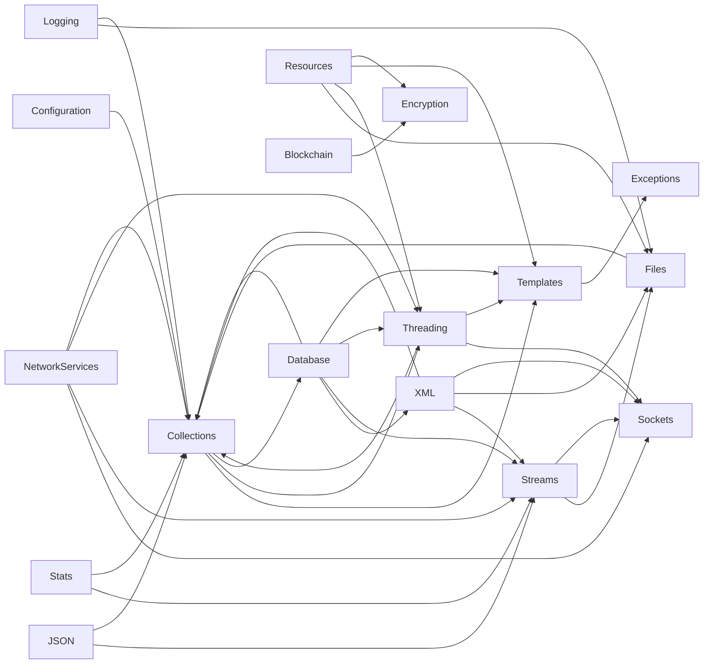
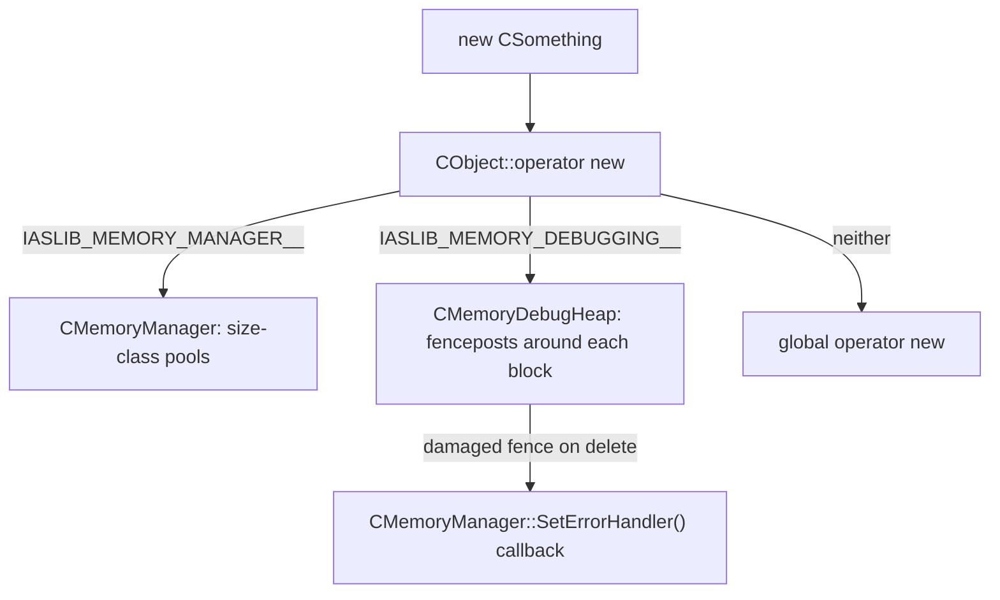
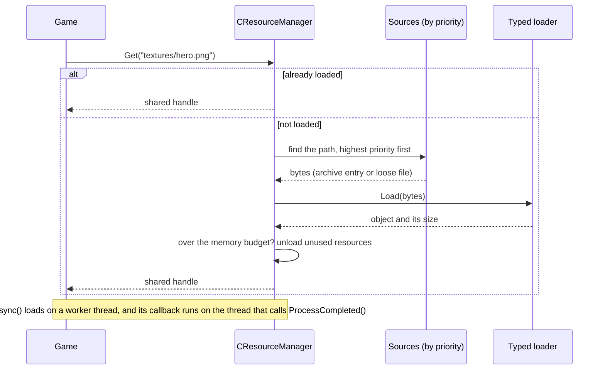
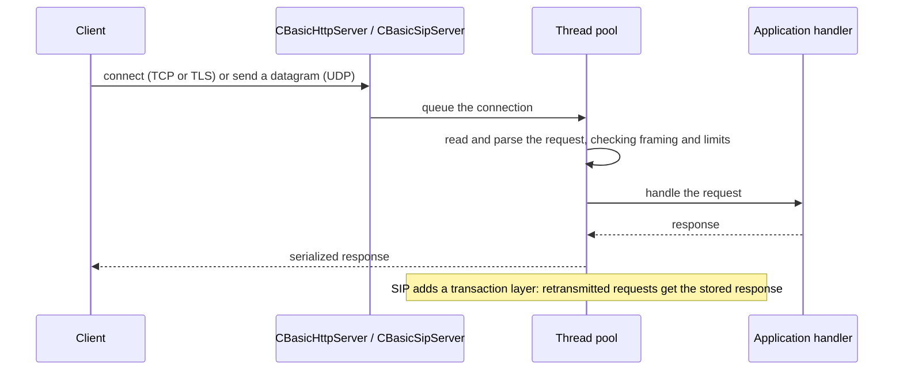
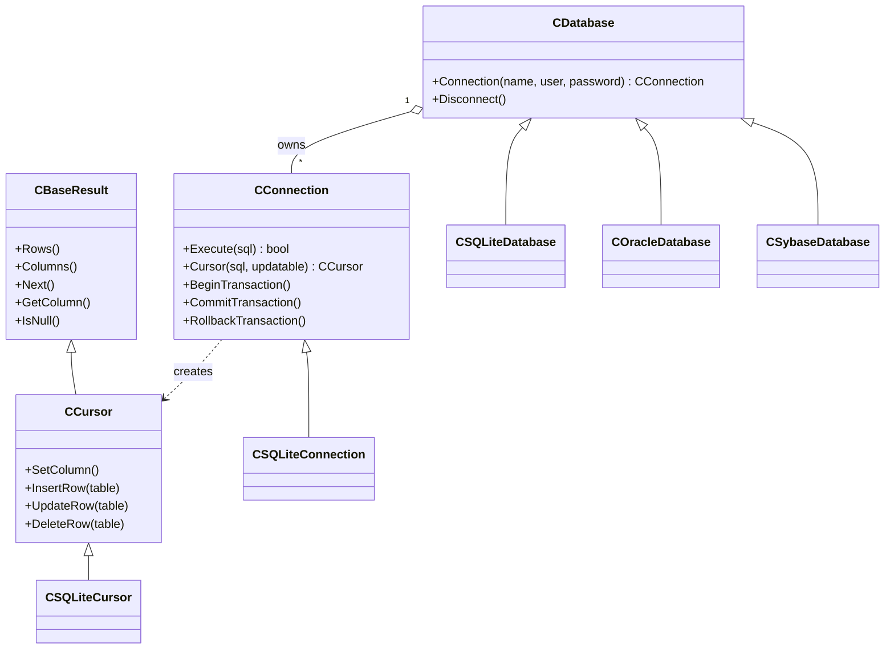

# Architecture {#architecture}

IASLib is one static library built from the folders under `inc/` and
`src/`. Each folder is a module. `IASLib.h` includes all of them, guarded
by the feature macros the build defines. This page shows how the modules
depend on one another, which build options turn each one on, and how the
main subsystems work.

## Modules

| Module | What it holds |
|---|---|
| BaseTypes | `CObject` and the RTTI macros, `CString`, `CDate` and time zones, `CDataBlock`, `CUuid`, `CVariant`, random numbers |
| Collections | `CArray`, `CHash`, `CList`, `CStringArray` and the other `CObject`-pointer collections |
| Templates | Type-safe template versions of every collection |
| Exceptions | `CException` and its subclasses, which keep a call stack as they are rethrown |
| Threading | `CThread`, `CMutex` (recursive), `CSemaphore`, thread pools and server threads |
| Sockets | TCP and UDP sockets, IPv4 and IPv6, TLS (`CTlsContext`, `CSecureSocket`) |
| Streams | `CStream` over files, sockets, strings and nothing (`CNullStream`) |
| Files | `CFile` with 64-bit offsets, `CMemMappedFile`, `CDirectory`, `CFileStat`, `CRWFile` |
| XML | `CXMLParser` and the document, element and index classes |
| JSON | A JSON reader and writer with a node tree |
| Logging | Log sinks (console, file, rotating file) and contexts |
| MemoryManager | An optional pooled allocator and the fencepost debug heap |
| Resources | A resource archive (one file of many named resources) and `CResourceManager` |
| Database | `CDatabase`/`CConnection`/`CCursor` with SQLite, Oracle and Sybase drivers, and table definitions from XML |
| NetworkServices | HTTP and SIP servers (and clients), and SMTP mail |
| Blockchain | Blocks, Merkle trees and a chain, hashed with SHA-256 |
| Configuration | `CProfile` (.INI files) and `CSettings` (name = value files) |
| Encryption | `CSHA256` |
| DynamicLibraries | `CDynamicLibrary`: shared libraries loaded at run time |
| Stats, Status | Histograms, coverage maps and CPU use; status reporting |

## How the modules depend on one another

An arrow points from a module to one it includes. BaseTypes sits under
everything, so its arrows are left out to keep the graph readable.



Collections and Threading include each other: `CHash` can be filled from a
database cursor, and the thread classes keep their lists in collections.
The cycle is only between headers. The library is built as one unit, so it
links without trouble.

## Build options

Each CMake option defines a macro that the headers test.

| CMake option | Default | Macro | Turns on |
|---|---|---|---|
| `USE_THREADS` | ON | `IASLIB_MULTI_THREADED__` (and `IASLIB_PTHREAD__` outside Windows) | Threading, and the locks the other modules take |
| `USE_NETWORK` | ON | `IASLIB_NETWORKING__` | Sockets, NetworkServices; `IASLIB_TLS__` too when OpenSSL is found |
| `USE_DATABASE` | ON | `IASLIB_DATABASE__` | Database |
| `USE_SQLITE` | ON | `IASLIB_DB_SQLITE__` | The SQLite driver (links SQLite) |
| `USE_ORACLE`, `USE_SYBASE`, `USE_MYSQL` | OFF | `IASLIB_DB_ORACLE__`, `IASLIB_DB_SYBASE__`, `IASLIB_DB_MYSQL__` | Those drivers (they need the vendors' client libraries) |
| `USE_JSON` | ON | `IASLIB_JSON_SUPPORT__` | JSON and Blockchain |
| `USE_RTTI` | ON | `IASLIB_RTTI__` | `CObject` type names and `IsType()` |
| `USE_DEBUG` | ON | `IASLIB_DEBUG__` | Assertions |
| `USE_MEMORY_MANAGER` | OFF | `IASLIB_MEMORY_MANAGER__` | Pooled allocation of every `CObject` |
| `USE_MEMORY_DEBUGGING` | ON | `IASLIB_MEMORY_DEBUGGING__` | Fencepost checks on every `CObject` allocation |
| `USE_HERSCHEL_CORRECTION` | OFF | `IASLIB_HERSCHEL_CORRECTION__` | `CDate` treats years divisible by 4000 as common years |
| `USE_TIMEZONE_ICU` | OFF | `IASLIB_TIMEZONE_ICU__` | Named time zones from ICU |

## Objects and memory

Every library class derives from `CObject`. `DECLARE_OBJECT` and
`DEFINE_OBJECT` give a class its name and type checks, and when a memory
option is on they send `new` and `delete` through the memory manager.



## Loading resources

`CResourceManager` puts a single view over several sources: resource
archives and folders of loose files, searched by priority. Typed loaders
turn bytes into objects, and handles share each loaded object.



## Serving HTTP and SIP

The servers accept on a listening socket and give each connection, or each
datagram for SIP over UDP, to a worker from a thread pool. The worker parses
the request, calls the application's handler, and writes the response.



## Database access



## Building the documentation

The **Documentation** workflow (`.github/workflows/docs.yml`) runs Doxygen
on the headers and this folder on every push. It builds the HTML site and,
through LaTeX, a PDF of the whole reference. It publishes the run's
`IASLib-documentation` artifact with:

- `IASLib-docs-html.zip`, the HTML site (open `html/index.html`);
- `IASLib-reference.pdf`, the full reference;
- `doxygen-warnings.log`, Doxygen's warnings.

To build them locally, with Doxygen, Graphviz and a LaTeX installation:

```sh
mkdir -p build/docs
doxygen Doxyfile                 # build/docs/html and build/docs/latex
make -C build/docs/latex         # build/docs/latex/refman.pdf
```
